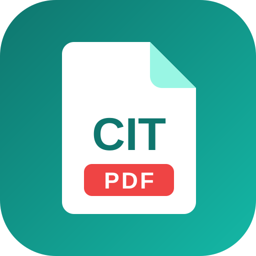
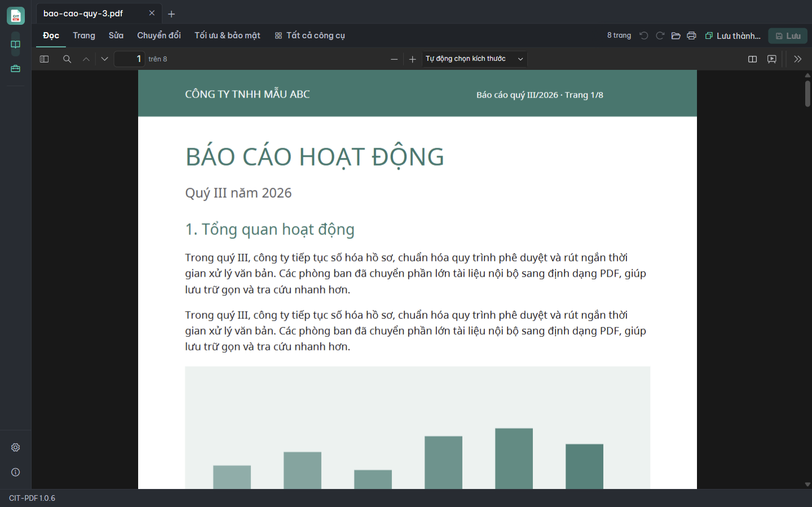
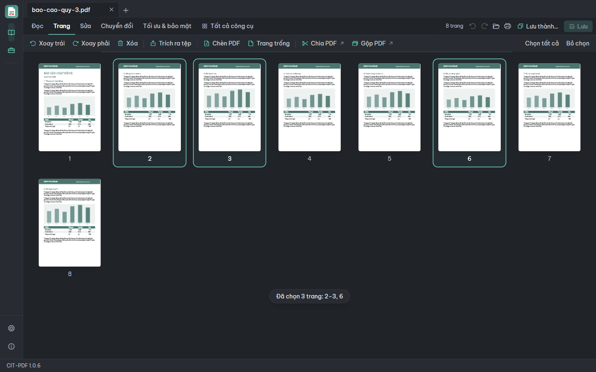
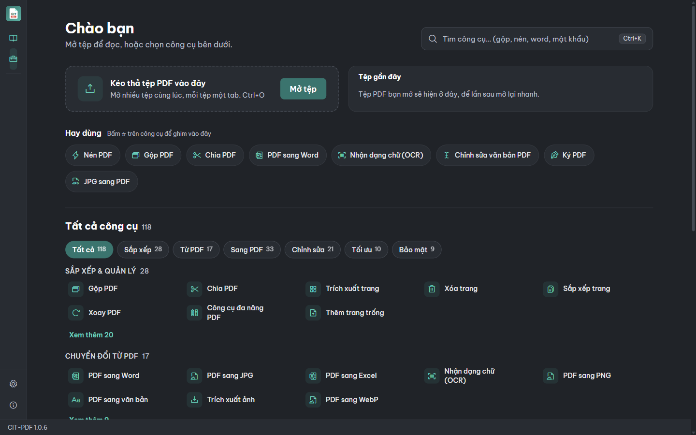
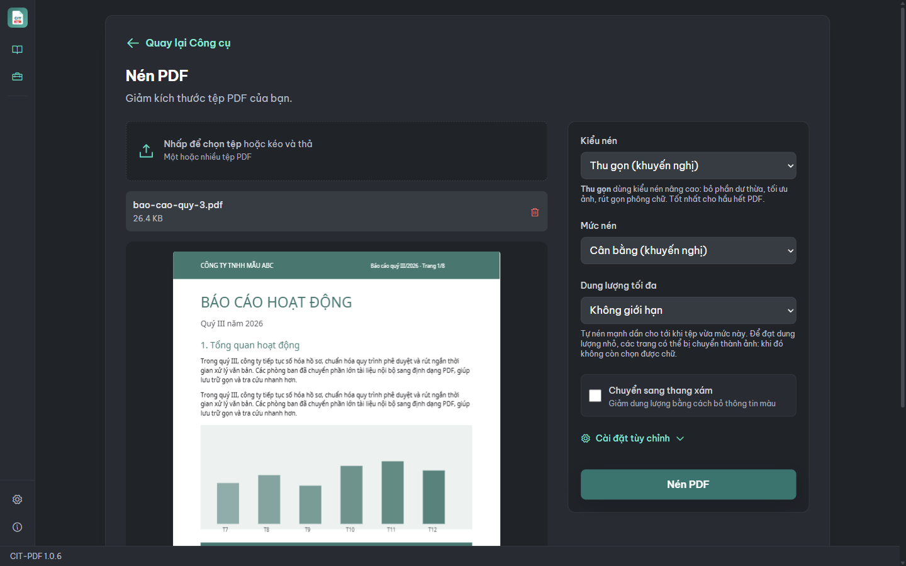
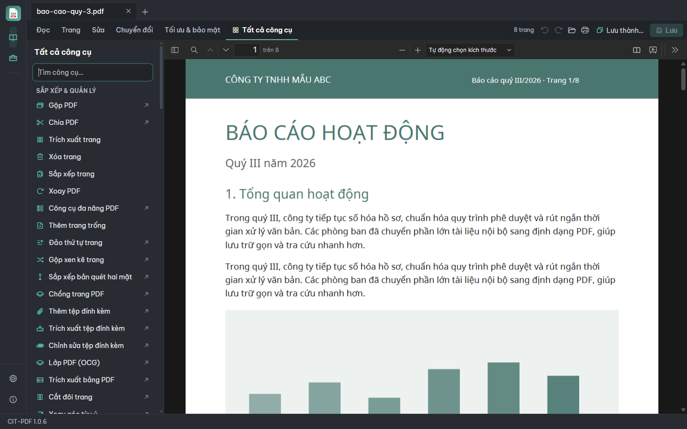
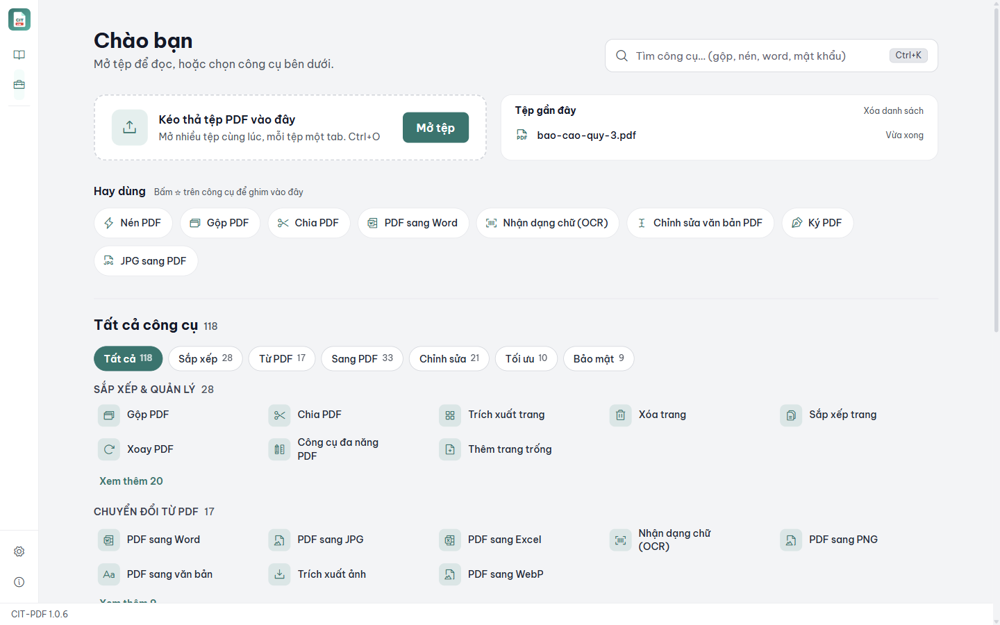

<p align="center">
  
</p>

<h1 align="center">CIT-PDF</h1>

<p align="center">
  <b>Bộ công cụ PDF tiếng Việt cho Windows, macOS và Linux: đọc, sửa, chuyển đổi, nén, ký và bảo vệ tài liệu.</b><br>
  Chạy hoàn toàn trên máy của bạn, tệp không bao giờ rời khỏi máy.
</p>

<p align="center">
  <a href="https://github.com/Cuongyd196/cit-pdf/releases/latest"></a>
  <a href="https://github.com/Cuongyd196/cit-pdf/releases"></a>
  
  <a href="LICENSE"></a>
</p>

<p align="center">
  <a href="https://github.com/Cuongyd196/cit-pdf/releases/latest"><b>⬇ Tải CIT-PDF</b></a>
  &nbsp;·&nbsp;
  <a href="#tính-năng">Tính năng</a>
  &nbsp;·&nbsp;
  <a href="#cài-đặt">Cài đặt</a>
  &nbsp;·&nbsp;
  <a href="https://github.com/Cuongyd196/cit-pdf/issues">Báo lỗi</a>
</p>

<p align="center">
  
</p>

## Vì sao chọn CIT-PDF

- 🔒 **Riêng tư tuyệt đối.** Mọi xử lý diễn ra ngay trên máy. Không tải tệp lên máy chủ, không cần tài khoản, dùng được cả khi không có mạng.
- 🇻🇳 **Thuần Việt.** Giao diện, tên công cụ và hướng dẫn bằng tiếng Việt dễ hiểu. Nhận dạng chữ (OCR) hỗ trợ tiếng Việt có dấu.
- 🧰 **Đủ việc văn phòng.** Hơn 100 công cụ: gộp, tách, nén, chuyển Word/Excel/PowerPoint, OCR bản scan, ký số, đặt mật khẩu…
- 🆓 **Miễn phí, mã nguồn mở.** Phát hành theo giấy phép AGPL-3.0.

## Tính năng

### Làm việc ngay trên tài liệu đang mở

Mở một tệp PDF là có thể đọc, tìm kiếm, in, và xử lý luôn bằng các thẻ phía trên: **Đọc · Trang · Sửa · Chuyển đổi · Tối ưu & bảo mật**. Mở nhiều tệp cùng lúc, mỗi tệp một tab.

Thẻ **Trang** hiện toàn bộ trang dạng lưới: chọn bằng chuột (giữ Ctrl hoặc Shift để chọn nhiều), rồi xoay, xóa, trích ra tệp mới, chèn PDF hoặc trang trống, cuối cùng bấm **Lưu**.

<p align="center">
  
</p>

### Hơn 100 công cụ, tìm trong một giây

Trang chủ gom toàn bộ công cụ theo nhóm, có ô tìm kiếm (gõ không dấu cũng được, phím tắt **Ctrl+K**), hàng **Hay dùng** để ghim công cụ quen tay, và danh sách tệp mở gần đây.

<p align="center">
  
</p>

| Nhóm                    | Một số công cụ                                                                                             |
| ----------------------- | ---------------------------------------------------------------------------------------------------------- |
| **Sắp xếp & quản lý**   | Gộp, chia, trích xuất, xóa, xoay, sắp xếp trang, thêm trang trống, gộp xen kẽ, sắp xếp bản quét hai mặt    |
| **Chuyển từ PDF**       | PDF sang Word, Excel, văn bản, JPG/PNG/WebP, trích xuất ảnh, trích xuất bảng                               |
| **Chuyển sang PDF**     | Word, Excel, PowerPoint, ảnh (JPG, PNG, HEIC…), văn bản, email, sách điện tử                               |
| **Chỉnh sửa & ghi chú** | Sửa chữ trực tiếp, ghi chú, ký, đóng dấu mờ, đánh số trang, đầu trang và chân trang, cắt lề, điền biểu mẫu |
| **Tối ưu & sửa lỗi**    | Nén (có giới hạn dung lượng tối đa), sửa PDF lỗi, PDF lưu trữ (PDF/A), sửa kích thước trang                |
| **Bảo mật**             | Đặt và gỡ mật khẩu, chữ ký số, xác minh chữ ký, xóa thông tin tệp, làm sạch PDF                            |

### Trang công cụ rõ ràng

Chọn tệp xong, trang chia hai cột: bên trái là tệp và ảnh trang đầu, bên phải là tùy chọn kèm nút chạy. Việc nặng chạy ở nền nên cửa sổ không bị đơ, kèm thời gian đã chạy.

<p align="center">
  
</p>

### Tất cả công cụ ngay bên cạnh tài liệu

Thẻ **Tất cả công cụ** trong trình xem liệt kê mọi công cụ. Công cụ làm được tại chỗ thì chạy ngay trên tài liệu đang mở; công cụ có trang riêng thì mang theo tài liệu sang đó.

<p align="center">
  
</p>

### Giao diện sáng và tối

<p align="center">
  
</p>

### Và hơn nữa

- **Mở tệp từ Windows:** chuột phải một tệp `.pdf`, chọn **Open with › CIT-PDF** (hoặc đặt CIT-PDF làm ứng dụng mặc định). Nhiều tệp vẫn chỉ dùng một cửa sổ.
- **Cập nhật một bước:** khi có bản mới, ứng dụng hiện hộp thoại với nút **Cập nhật và khởi động lại**. Ứng dụng tự tải bản cài đặt, kiểm tra mã SHA-256 rồi cài đè.
- **Dùng được ở mạng bị chặn:** cài bộ xử lý từ một thư mục chép từ máy khác (Cài đặt › Bộ xử lý › _Cài từ thư mục…_).
- **Tiếng Việt hoặc English,** đổi trong Cài đặt.

## Cài đặt

Tải tại trang [**Releases**](https://github.com/Cuongyd196/cit-pdf/releases/latest).

| Hệ điều hành                  | Tệp                                            | Ghi chú                                                                                              |
| ----------------------------- | ---------------------------------------------- | ---------------------------------------------------------------------------------------------------- |
| Windows 10/11 (64-bit)        | `CIT-PDF-<phiên bản>-Windows-x64-Setup.exe`    | **Nên dùng.** Cài cho tài khoản đang đăng nhập, không cần quyền Administrator. Có cập nhật một bước. |
| Windows 10/11 (64-bit)        | `CIT-PDF-<phiên bản>-Windows-x64-Portable.exe` | Chạy thẳng không cần cài, chép được sang USB.                                                        |
| macOS (chip Apple M1 trở lên) | `CIT-PDF-<phiên bản>-macOS-arm64.dmg`          | Mở tệp, kéo CIT-PDF vào Applications.                                                                |
| macOS (chip Intel)            | `CIT-PDF-<phiên bản>-macOS-x64.dmg`            | Như trên.                                                                                            |
| Ubuntu / Debian               | `CIT-PDF-<phiên bản>-Linux-amd64.deb`          | `sudo apt install ./CIT-PDF-<phiên bản>-Linux-amd64.deb`                                             |
| Linux khác                    | `CIT-PDF-<phiên bản>-Linux-x86_64.AppImage`    | `chmod +x` rồi chạy, không cần cài.                                                                  |

Mỗi bản phát hành ghi kèm mã **SHA-256** của từng tệp để bạn đối chiếu.

> Các bộ cài chưa có chữ ký số của nhà phát hành.
>
> - **Windows** có thể hiện cảnh báo SmartScreen: bấm **More info › Run anyway**.
> - **macOS** chặn lần mở đầu: chuột phải vào CIT-PDF › **Open** › **Open**, hoặc chạy `xattr -cr /Applications/CIT-PDF.app` trong Terminal.
>
> Nút "Cập nhật và khởi động lại" hiện chỉ có trên bản cài Windows; trên macOS và Linux nút này mở trang tải.

### Bộ xử lý tải khi dùng lần đầu

Bộ cài chỉ chứa phần lõi (khoảng 145 MB). Các bộ xử lý nặng được tải một lần khi bạn dùng công cụ cần đến chúng, kiểm tra mã băm, rồi lưu trên máy để dùng cả khi không có mạng. Khi tải, ứng dụng hiện dung lượng, phần trăm và cho phép hủy.

| Bộ xử lý           | Dùng cho                                             | Nguồn                  | Kiểm tra         |
| ------------------ | ---------------------------------------------------- | ---------------------- | ---------------- |
| PyMuPDF            | PDF sang Word, Excel, văn bản                        | npm registry           | SHA-512          |
| Ghostscript        | Nén mạnh, PDF/A                                      | npm registry           | SHA-512          |
| LibreOffice        | Word, Excel, PowerPoint sang PDF                     | kho mã nguồn của dự án | SHA-256 từng tệp |
| Tesseract OCR      | Nhận dạng chữ trong bản scan (tiếng Việt, tiếng Anh) | có sẵn trong bộ cài    | không cần tải    |
| CoherentPDF (cpdf) | Xử lý trang                                          | có sẵn trong bộ cài    | không cần tải    |

Có thể tải trước toàn bộ hoặc xóa bớt cho nhẹ ổ đĩa trong **Cài đặt › Bộ xử lý**.

## Build từ mã nguồn

Cần Node.js 20 trở lên.

```bash
git clone https://github.com/Cuongyd196/cit-pdf.git
cd cit-pdf
npm install

npm run desktop              # build và chạy ứng dụng
npm run desktop:build        # chỉ build
npm run desktop:dist         # đóng gói bộ cài Windows vào release/
# macOS và Linux: workflow .github/workflows/desktop-release.yml (chạy tay với tag)
npm run desktop:modules-pack # gói bộ xử lý ngoại tuyến cho mạng bị chặn
```

Trong terminal của VS Code, biến `ELECTRON_RUN_AS_NODE=1` được đặt sẵn và làm Electron chạy như Node thường. Hãy bỏ biến này trước khi chạy `npm run desktop`.

Kiến trúc bản desktop được mô tả trong [DESKTOP.md](DESKTOP.md). Hướng dẫn gốc của BentoPDF cho bản web (Docker, self-host, cấu hình WASM) được giữ nguyên tại [README.bentopdf.md](README.bentopdf.md).

## Thay đổi so với BentoPDF

CIT-PDF là bản sửa đổi (fork) của [BentoPDF](https://github.com/alam00000/bentopdf) 2.8.8, do Cường IT đóng gói thành ứng dụng desktop trong năm 2026. Đây **không phải** sản phẩm chính thức của BentoPDF.

- Thêm lớp vỏ Electron (`desktop/`) với giao thức `app://` riêng để chạy ứng dụng không cần máy chủ web.
- Thêm trình quản lý bộ xử lý (`desktop/src/modules-manager.ts`): tải, kiểm tra mã băm, lưu trên máy, cho hủy giữa chừng, và cài từ gói ngoại tuyến.
- Thêm giao diện desktop (`src/js/desktop/`): thanh biểu tượng, trang chủ, trình xem có các thẻ làm việc và lưới trang, trang công cụ hai cột, hộp thoại cập nhật, cùng hai trang `cit-about.html` và `cit-settings.html`.
- Chạy PyMuPDF và Ghostscript trong worker để giao diện không bị đơ.
- Đổi tên, logo, ngôn ngữ mặc định (tiếng Việt) và Việt hóa tên công cụ.
- Thêm script build và cấu hình đóng gói (`scripts/build-desktop.mjs`, `electron-builder.json`).

Phần xử lý PDF của BentoPDF được giữ nguyên, kể cả dòng producer trong metadata của các tệp PDF xuất ra.

## Giấy phép

CIT-PDF được phát hành theo [GNU AGPL-3.0](LICENSE). Bạn được dùng, sửa đổi và phân phối lại, với điều kiện bản phân phối của bạn cũng công khai mã nguồn theo AGPL-3.0.

- Bản quyền phần mã gốc: © BentoPDF Contributors.
- Bản quyền phần sửa đổi: © 2026 Cường IT.
- Mã nguồn tương ứng với từng bản phát hành nằm tại tag cùng số phiên bản trong kho này.

BentoPDF còn có giấy phép thương mại riêng cho ai muốn dùng trong sản phẩm đóng nguồn; xem [bentopdf.com/licensing.html](https://bentopdf.com/licensing.html). CIT-PDF không cấp giấy phép đó.

### Thành phần bên thứ ba

| Thành phần                                      | Giấy phép  | Mã nguồn                                                                                                         |
| ----------------------------------------------- | ---------- | ---------------------------------------------------------------------------------------------------------------- |
| BentoPDF                                        | AGPL-3.0   | [alam00000/bentopdf](https://github.com/alam00000/bentopdf)                                                      |
| PyMuPDF                                         | AGPL-3.0   | [pymupdf/PyMuPDF](https://github.com/pymupdf/PyMuPDF)                                                            |
| Ghostscript                                     | AGPL-3.0   | [ArtifexSoftware/ghostpdl](https://github.com/ArtifexSoftware/ghostpdl)                                          |
| CoherentPDF (cpdf)                              | AGPL-3.0   | [coherentgraphics/coherentpdf.js](https://github.com/coherentgraphics/coherentpdf.js)                            |
| LibreOffice                                     | MPL-2.0    | [libreoffice.org](https://www.libreoffice.org/about-us/source-code/)                                             |
| Tesseract OCR, tesseract.js và dữ liệu ngôn ngữ | Apache-2.0 | [tesseract-ocr](https://github.com/tesseract-ocr), [naptha/tesseract.js](https://github.com/naptha/tesseract.js) |
| Noto Sans (font chữ cho OCR)                    | OFL-1.1    | [googlefonts/noto-fonts](https://github.com/googlefonts/noto-fonts)                                              |
| Inter (font giao diện)                          | OFL-1.1    | [rsms/inter](https://github.com/rsms/inter)                                                                      |

## Ghi nhận

Cảm ơn nhóm tác giả và cộng đồng BentoPDF đã xây dựng bộ công cụ gốc. Lỗi liên quan đến bản desktop CIT-PDF xin báo tại [Issues](https://github.com/Cuongyd196/cit-pdf/issues) của kho này, không báo cho BentoPDF.

<sub>Ảnh minh họa dùng một tài liệu mẫu hư cấu.</sub>
